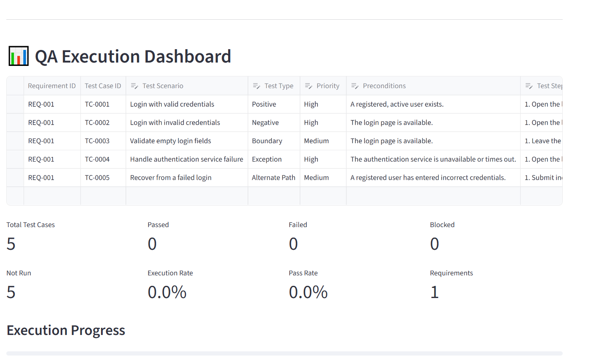
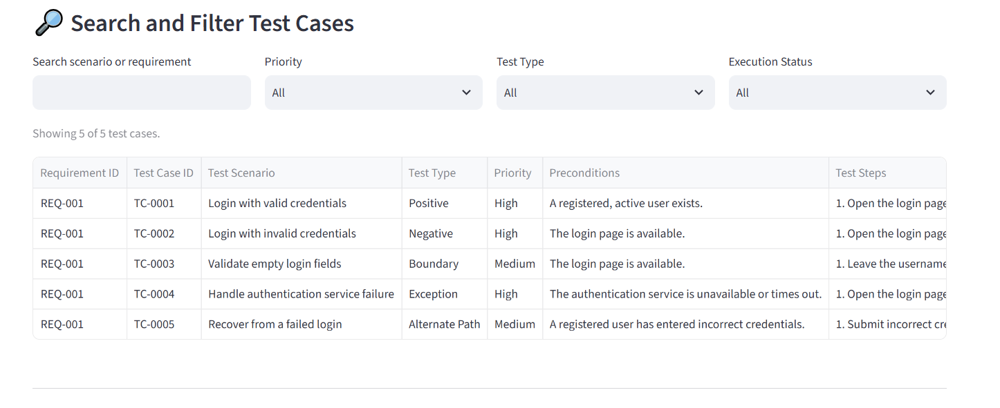
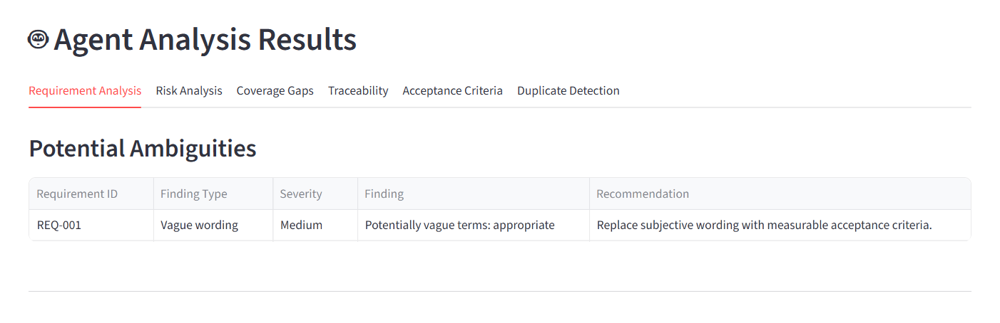
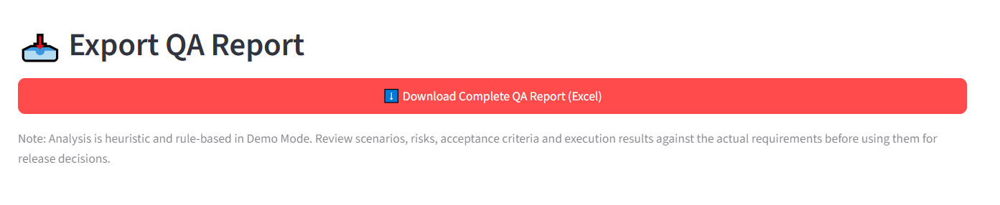
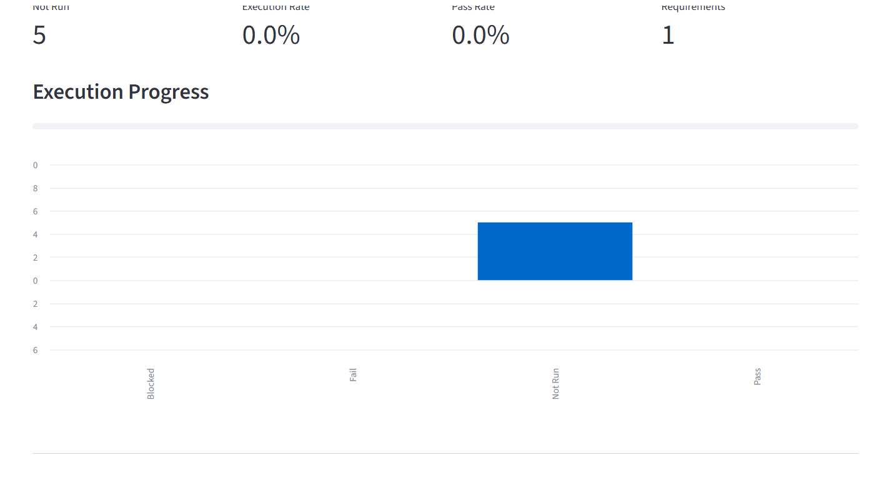

[](https://github.com/Sushmak02-ctrl/multi-agent-ai-test-assistant/actions/workflows/tests.yml)

# 🧪 Multi-Agent AI Test Assistant

A Streamlit-based QA testing assistant that helps transform requirements into structured test cases, identify potential quality risks, assess coverage, and export QA reports to Excel.

## Overview

The Multi-Agent AI Test Assistant uses a modular, rule-based analysis approach to support common software testing activities. It is designed to help QA engineers organise requirements, develop test scenarios, review potential gaps, and prepare test execution reports.

**The current implementation runs without requiring an external AI API key.**

## Features

- **Test Case Generation:** Generate structured test cases from supplied requirements.
- **Requirement Analysis:** Identify potential ambiguities in requirements.
- **Risk Assessment:** Highlight potential requirement-related risks.
- **Coverage Gap Analysis:** Identify areas that may need additional test coverage.
- **Duplicate Scenario Detection:** Flag potentially duplicate test scenarios.
- **Requirement Traceability:** Build a requirement traceability matrix.
- **Acceptance Criteria Suggestions:** Generate suggested acceptance criteria from requirements.
- **QA Execution Dashboard:** Review test execution progress and work with test case data.
- **Search and Filtering:** Find relevant test cases more efficiently.
- **Excel Report Export:** Export QA reporting data into Excel workbooks.

## Technology Stack

- **Language:** Python
- **Application Framework:** Streamlit
- **Data Processing:** pandas
- **Excel Reporting:** openpyxl
- **Automated Testing:** pytest, Streamlit AppTest
- **Continuous Integration:** GitHub Actions
- **Version Control:** Git and GitHub

## Automated Testing

The project includes automated tests to verify key application behavior.

- Application startup validation
- Empty-requirements input validation
- Automated test execution with pytest
- GitHub Actions workflow for continuous integration

### Run Tests Locally

Activate your virtual environment, then run:

```bash
python -m pytest -v
```

GitHub Actions runs the test suite automatically on pushes and pull requests targeting the `main` branch.

## Project Structure

MultiAgentAITestAssistant/
├── .github/
│   └── workflows/
│       └── tests.yml
├── Screenshots/
│   ├── Search-filter-testcases.PNG
│   ├── analysis-results.PNG
│   ├── qa-dashboard1.PNG
│   ├── qa-dashboard2.PNG
│   └── qa-report.PNG
├── tests/
│   └── test_app.py
├── app.py
├── requirements.txt
├── README.md
└── .gitignore

## 📸 Application Screenshots

### 1. QA Dashboard



### 2. Generated Test Cases and Search Filters



### 3. Agent Analysis Results



### 4. Excel Report Export



### 5. Additional Dashboard View




## Getting Started

### Prerequisites

- Python installed on your computer
- pip, Python's package installer

### 1. Clone the repository

```bash
git clone https://github.com/Sushmak02-ctrl/multi-agent-ai-test-assistant.git
cd multi-agent-ai-test-assistant
```

### 2. Create a virtual environment

```bash
python -m venv .venv
```

Activate it on Windows PowerShell:

```powershell
.\.venv\Scripts\Activate.ps1
```

### 3. Install dependencies

```bash
python -m pip install -r requirements.txt
```

### 4. Run the application

```bash
streamlit run app.py
```

Streamlit will provide a local URL in the terminal. Open that URL in your browser to use the application.

## Example QA Workflow

1. Provide requirements for analysis.
2. Generate test cases using the available generation settings.
3. Review potential ambiguities and requirement risks.
4. Examine coverage gaps and possible duplicate scenarios.
5. Review requirement traceability and suggested acceptance criteria.
6. Use the dashboard to search, filter, and review test cases.
7. Export the QA report to Excel.

## Security

- Do not commit `.env` files, API keys, passwords, or other credentials.
- Keep virtual environments and local backup files out of version control.
- Review generated test cases and analysis findings before using them in a formal testing process.

## Limitations

The current implementation uses rule-based generation and analysis. Results are suggestions to support QA review, not a substitute for professional test design or execution. Potential risks, duplicates, and coverage gaps should be validated against the actual requirements.

## Author

**Susan Kakde**

GitHub: [Sushmak02-ctrl](https://github.com/Sushmak02-ctrl)

## Disclaimer

This project is intended for learning, demonstration, and QA workflow support. Validate all generated outputs before using them in production testing.
